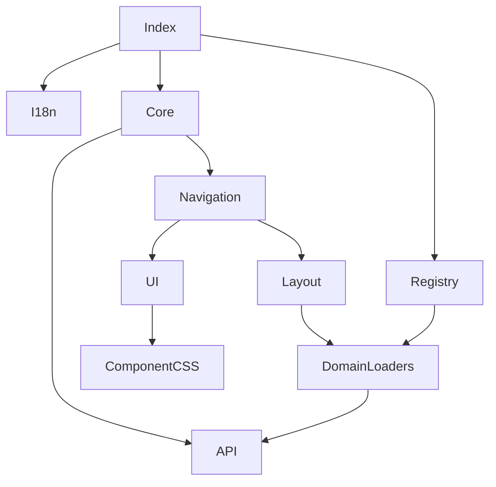

# AR-03 Admin responsibility ledger

Baseline: `36832c6f904fa41b0b922fa69fb4c7354afbe898`; 67 fragments, 40 scripts. Private state and production credentials are never loaded.

## Baseline and dependency graph

P0: Layout owns both node movement and domain refresh; navigation generation only guards shell callbacks; inline actions rely on window exports. P1: core mixes API, navigation, observer, events, editors and toast; component styling is shared but enhancement ownership is implicit. P2: domain-specific renderers remain domain owned.

A baseline: 268 page/version/width projections PASS (67 × legacy/new × 1440/480), dictionary/dialog/i18n/node/draft identity PASS. `admin_ui_versions_browser` fails 27 != 9 (read-only aggregation initialization), business browser fails field/save gap. Evidence: ignored `.tmp/ar03/baseline*.{json,log}`, `.tmp/admin-all/` screenshots. AST inventory: `.tmp/ar03/dependencies-before.json`, reproducible with `NODE_PATH=.tmp/browser/node_modules node tests/admin_dependency_index.cjs` (acorn 8.15.0).

## Page ownership

Every row uses the original `#page-<id>` container, global api/auth singleton, shared card/button/field/status/modal styles. Loaders are recorded in the single `AdminPageRegistry`; API calls and global references for each domain are enumerated by the AST inventory. Containers are retained on suspend; explicit reload replaces contents; logout invalidates navigation. Global actions remain compatibility consumers of HTML data-action until domain migration.

| Page / fragment | Action owners | Components |
|---|---|---|
| `agent-runtime-browser` | `js/core.js` |  |
| `auth-tokens` | `js/core.js`, `js/settings.js` | card, btn, badge |
| `autonomy-settings` | `js/observability.js`, `js/video-call-presence.js` | card, btn, field, modal, badge |
| `call-records` | `js/settings-center.js` | btn, field |
| `character-behavior` |  |  |
| `character-cleanup` | `js/character-cleanup.js` | card, btn, field |
| `character` | `js/character.js`, `js/core.js` | card, btn, field, badge |
| `client-settings` | `js/client-settings.js`, `js/core.js`, `js/scheduler.js` | card, btn, field |
| `conversation-settings` | `js/lorebook.js`, `js/settings.js` | card, btn, field |
| `coplay-config` | `js/setup.js` | card, btn, modal, badge |
| `data-management` | `js/settings-center.js` | card, btn, field |
| `device-policy` | `js/relationship.js` | card, btn, field |
| `diary-config` | `js/setup.js` | card, btn, field, modal, badge |
| `dream-settings` | `js/dream-settings.js` | card, btn, field |
| `embedding-config` | `js/setup.js` | card, btn, field, modal, badge |
| `feature-center` |  | field |
| `frozen-features` | `js/agent-runtime-browser.js`, `js/memory-event-control.js`, `js/observability.js`, `js/runtime-config.js`, `js/settings.js` | card, btn, field |
| `generation-debug` | `js/mcp.js`, `js/observability.js` | card, btn, field |
| `guide` | `js/core.js` | card, btn |
| `integrations` |  | card, badge |
| `listening-player` | `js/listening-player.js` | card, btn, field |
| `local-model-runtime` | `js/local-runtime.js` | card, btn, field, modal |
| `logs` | `js/status-users.js` | card, btn, field |
| `lorebook` | `js/lorebook.js` | card, btn, modal |
| `mail-config` | `js/setup.js` | card, btn, field, modal, badge |
| `mcp` | `js/mcp.js` | card, btn, field |
| `memory-consolidation` | `js/observability.js` | card, btn, field |
| `minecraft` | `js/minecraft.js` | card, btn, field |
| `model-routing` | `js/core.js`, `js/image-generation.js`, `js/settings-center.js`, `js/settings.js` | card, btn, field, modal |
| `network-config` | `js/core.js`, `js/settings.js` | card, btn, field, badge |
| `observation-center` | `js/core.js`, `js/settings-center.js` | card, btn |
| `observe-api-contract` | `js/observability.js` | btn |
| `observe-autonomy` | `js/observability.js` | card, btn |
| `observe-char-permissions` | `js/observability.js` | btn |
| `observe-dream-operations` | `js/dream-operations.js` | card, btn |
| `observe-dream-prompt` | `js/observability.js` | card, btn |
| `observe-dream` | `js/observability.js` | card, btn |
| `observe-group-arbiter` | `js/observability.js` | card, btn |
| `observe-hidden` | `js/observability.js` | card, btn |
| `observe-listening` | `js/core.js`, `js/observability.js` | card, btn, field |
| `observe-memory-events` | `js/memory-event-control.js`, `js/observability.js` | card, btn |
| `observe-memory-summary` | `js/observability.js` | card, btn |
| `observe-memory` | `js/observability.js` | card, btn |
| `observe-mood` | `js/observability.js` | card, btn |
| `observe-prompt` | `js/observability.js` | card, btn |
| `observe-provenance` | `js/provenance-vector.js` | btn, field |
| `observe-resource-completeness` | `js/observability.js` | btn |
| `observe-runtime-signals` | `js/observability.js` | btn |
| `observe-runtime` | `js/observability.js` | card, btn |
| `observe-spend` | `js/observability.js` | card, btn |
| `observe-system-diagnosis` |  |  |
| `observe-tools` | `js/observability.js` | btn |
| `observe-vector` | `js/provenance-vector.js` | btn |
| `observe-visual` | `js/observability.js` | card, btn |
| `output-settings` | `js/character.js` | card, btn, field |
| `owner-turn-api` | `js/core.js`, `js/owner-turn-api.js` | card, btn, field, badge |
| `personal-settings` | `js/setup.js` | card, btn, modal, badge |
| `relationship-facts` | `js/relationship.js` | card, btn, field |
| `role-bindings` |  | field |
| `runtime-config` | `js/core.js`, `js/status-users.js` | card, btn |
| `scheduler` | `js/core.js`, `js/scheduler.js` | card, btn, field |
| `service-center` | `js/core.js`, `js/settings-center.js` | card, btn |
| `setup` | `js/core.js`, `js/setup.js` | card, btn, field, modal, badge |
| `status` | `js/core.js`, `js/overview.js`, `js/status-users.js` | card, btn, badge |
| `tools` | `js/tools.js` | card, btn, field, badge |
| `tts-config` | `js/character.js` | card, btn, field, badge |
| `user-data` |  |  |

## Asset order and CSS ownership

- `/static/js/admin-theme-boot.js?v=theme-first-paint-295`
- `/static/js/admin-theme.js?v=theme-first-paint-295`
- `/static/js/ui-version-boot.js?v=theme-first-paint-295`
- `/static/i18n.js?v=ar01-modules-325`
- `/static/js/i18n-runtime.js?v=ar01-modules-325`
- `/static/js/admin-page-registry.js?v=ar01-modules-325`
- `/static/js/core.js?v=ar01-modules-325`
- `/static/js/overview.js?v=brief-180-admin-static-1`
- `/static/js/setup.js?v=behavior-recovery-20261115`
- `/static/js/mcp.js?v=288-permissions-final-20261013`
- `/static/js/admin-page-layout.js?v=behavior-recovery-20261115`
- `/static/js/ui-version.js?v=admin-latency-20261115`
- `/static/js/tools.js?v=288-frozen-20261012`
- `/static/js/status-users.js?v=admin-editor-20261011`
- `/static/js/runtime-config.js?v=288-experiments-20261013`
- `/static/js/lorebook.js?v=288-owned-entries-20261013`
- `/static/js/settings.js?v=openlux-stream-1`
- `/static/js/image-generation.js?v=gmail-304`
- `/static/js/owner-turn-api.js?v=brief-173-owner-turn-1`
- `/static/js/agent-runtime-browser.js?v=brief-239-browser-admin-1`
- `/static/js/relationship.js?v=browser-workbench-314`
- `/static/js/character.js?v=dist-04-stt`
- `/static/js/scheduler.js?v=289-first-run-20261013`
- `/static/js/integrations.js?v=brief-160-garden-freeze-1`
- `/static/js/observability.js?v=intention-311-ci`
- `/static/js/memory-event-control.js?v=288-frozen-20261012`
- `/static/js/dream-operations.js?v=brief-175-scenario-reconciler-1`
- `/static/js/user-data.js?v=asset-partial-20261011`
- `/static/js/character-cleanup.js?v=admin-editor-20261011`
- `/static/js/dream-settings.js?v=brief-223-rpg-dream-admin-2`
- `/static/js/provenance-vector.js?v=brief-251-thinking-cache-mcp-1`
- `/static/js/settings-center.js?v=affect-20261025`
- `/static/js/admin-design.js?v=admin-consolidation-1`
- `/static/js/listening-player.js?v=v1-260-admin-surface-1`
- `/static/js/local-runtime.js?v=v1-stt-sherpa-1`
- `/static/js/video-call-presence.js?v=v1-call-presence-1`
- `/static/js/client-settings.js?v=mobile-r2-20261025`
- `/static/js/minecraft.js?v=289-first-run-20261013`
- `/static/js/admin-copy.js?v=admin-latency-20261115`
- `/static/js/admin-editor.js?v=admin-latency-20261115`

- `/static/style.css?v=289-first-run-20261013`
- `/static/admin-design.css?v=admin-design-1`
- `/static/admin-v2.css?v=admin-latency-20261115`
- `/static/admin-components-v2.css?v=default-new-fast-20261027`
- `/static/admin-theme.css?v=theme-first-paint-295`

`style.css`: legacy base; `admin-design.css`: layouts/disclosures; `admin-v2.css`: semantic pk tokens and pk-ui components; `admin-components-v2.css`: scoped new-mode components and legacy token aliases; `admin-theme.css`: explicit theme/palette overrides. Keep the legacy cascade; no broad priority deletion without computed-style evidence.

Safe deletion candidate: disabled page-context implementation (already returns immediately). Preserve: old UI, global handlers consumed by fragments, player/media specialized controls, native details and MCP folding. These have distinct interaction contracts. No unrelated cleanup authorized.

## B: shared responsibility extraction

`core.js` retains auth/session state and prompt-language compatibility. API/deadline,
navigation/fragment/history, event adapters, batched observers, mobile shell,
structured editors, and feedback each have one shared owner under `js/shared/`.
Classic exports preserve existing domain and HTML consumers without wrappers or
duplicate state. Registry descriptors identify fragment, domain owners, loader and
keep-draft retention from the same registration map. Dead introduction code was
removed; navigation ignores stale completion decoration. Existing async domain
loaders still own their internal rendering; generation is not a claim that all
domain writes have been converted to cancellable controllers.

Verification: isolated navigation, acceptance and all 268 modularization projections;
cache URLs updated as one batch. No API/schema/scope/client changes.

## C: component lifecycle

`shared/presentation.js` owns existing Card/Accordion and semantic signal projection;
`ui-version.js` owns mode and its single batched observer. `shared/events.js` owns
the sole HTML action bridge with WeakSet-based enhance/dispose (cloned attributes
cannot pretend to own listeners). `shared/form-editors.js` owns repeated Field/
Input/Select render/read/validation; CSS continues to style existing Button/Switch/
Field nodes without replacing them. `shared/feedback.js` remains the single Toast.
`shared/modal.js` owns Tab/ESC/focus; lorebook, relationship, memory, preset/profile,
token creation and Dream dialogs retain their domain validation and close callbacks.
One-time token success dialogs retain their specialized secret-clearing lifecycle.
Native details, MCP triangles, player/media and code editors keep their own controls.

Chromium component contract passes repeated enhance/dispose/remount, single action,
injected duplicate listener detection, folding, draft identity, and modal keyboard/
focus restoration. All 268 page projections still exactly equal baseline. Existing
forms are never cloned. The new component contract runs on public assets only.

## D: token and cascade ownership

`admin-tokens.css` is the single default semantic token authority, extracted without
changing values from `admin-v2.css`. The latter retains pk-ui component styling and
fonts; scoped new-mode component rules retain legacy aliases; theme/palette overrides
remain last. Repeated 6px control radius and focus constants now refer to tokens.
No priority changes or legacy style deletion. Chromium samples six domains at
1440/1024/768/480 and day/night in `.tmp/ar03/component-styles.json`.

The business spacing failure was a test precondition bug: xhs controls were moved
to `#page-character-behavior` (display:none while Feature Center was active), so both
rectangles were zero despite 16px field margin. Navigating to the actual owner makes
the existing >=16px assertion pass. CSS gap is preserved at baseline; no reduced
threshold and no cosmetic workaround. Full business runner now completes successfully.
