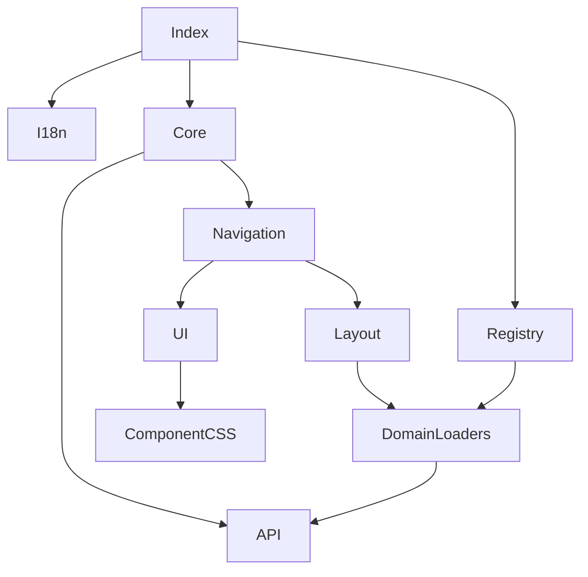

# AR-03 Admin responsibility ledger

Baseline: `36832c6f904fa41b0b922fa69fb4c7354afbe898`; 67 fragments, 40 scripts. Private state and production credentials are never loaded.

## Baseline and dependency graph

P0: Layout owns both node movement and domain refresh; navigation generation only guards shell callbacks; inline actions rely on window exports. P1: core mixes API, navigation, observer, events, editors and toast; component styling is shared but enhancement ownership is implicit. P2: domain-specific renderers remain domain owned.

A baseline: 268 page/version/width projections PASS (67 × legacy/new × 1440/480), dictionary/dialog/i18n/node/draft identity PASS. `admin_ui_versions_browser` fails 27 != 9 (read-only aggregation initialization), business browser fails field/save gap. Evidence: ignored `.tmp/ar03/baseline*.{json,log}`, `.tmp/admin-all/` screenshots. AST inventory: `.tmp/ar03/dependencies-before.json`, reproducible with `NODE_PATH=.tmp/browser/node_modules node tests/admin_dependency_index.cjs` (acorn 8.15.0).

## Page ownership

Every row uses the original `#page-<id>` container, global api/auth singleton, shared card/button/field/status/modal styles. Loaders are recorded in the single `AdminPageRegistry`; API calls and global references for each domain are enumerated by the AST inventory. Containers are retained on suspend; explicit reload replaces contents; logout invalidates navigation. Global actions remain compatibility consumers of HTML data-action until domain migration.

| Page / fragment | Action owners | Components |
|---|---|---|
| `agent-runtime-browser` | `js/core.js` |  |
| `auth-tokens` | `js/core.js`, `js/settings.js` | card, btn, badge |
| `autonomy-settings` | `js/observability.js`, `js/video-call-presence.js` | card, btn, field, modal, badge |
| `call-records` | `js/settings-center.js` | btn, field |
| `character-behavior` |  |  |
| `character-cleanup` | `js/character-cleanup.js` | card, btn, field |
| `character` | `js/character.js`, `js/core.js` | card, btn, field, badge |
| `client-settings` | `js/client-settings.js`, `js/core.js`, `js/scheduler.js` | card, btn, field |
| `conversation-settings` | `js/lorebook.js`, `js/settings.js` | card, btn, field |
| `coplay-config` | `js/setup.js` | card, btn, modal, badge |
| `data-management` | `js/settings-center.js` | card, btn, field |
| `device-policy` | `js/relationship.js` | card, btn, field |
| `diary-config` | `js/setup.js` | card, btn, field, modal, badge |
| `dream-settings` | `js/dream-settings.js` | card, btn, field |
| `embedding-config` | `js/setup.js` | card, btn, field, modal, badge |
| `feature-center` |  | field |
| `frozen-features` | `js/agent-runtime-browser.js`, `js/memory-event-control.js`, `js/observability.js`, `js/runtime-config.js`, `js/settings.js` | card, btn, field |
| `generation-debug` | `js/mcp.js`, `js/observability.js` | card, btn, field |
| `guide` | `js/core.js` | card, btn |
| `integrations` |  | card, badge |
| `listening-player` | `js/listening-player.js` | card, btn, field |
| `local-model-runtime` | `js/local-runtime.js` | card, btn, field, modal |
| `logs` | `js/status-users.js` | card, btn, field |
| `lorebook` | `js/lorebook.js` | card, btn, modal |
| `mail-config` | `js/setup.js` | card, btn, field, modal, badge |
| `mcp` | `js/mcp.js` | card, btn, field |
| `memory-consolidation` | `js/observability.js` | card, btn, field |
| `minecraft` | `js/minecraft.js` | card, btn, field |
| `model-routing` | `js/core.js`, `js/image-generation.js`, `js/settings-center.js`, `js/settings.js` | card, btn, field, modal |
| `network-config` | `js/core.js`, `js/settings.js` | card, btn, field, badge |
| `observation-center` | `js/core.js`, `js/settings-center.js` | card, btn |
| `observe-api-contract` | `js/observability.js` | btn |
| `observe-autonomy` | `js/observability.js` | card, btn |
| `observe-char-permissions` | `js/observability.js` | btn |
| `observe-dream-operations` | `js/dream-operations.js` | card, btn |
| `observe-dream-prompt` | `js/observability.js` | card, btn |
| `observe-dream` | `js/observability.js` | card, btn |
| `observe-group-arbiter` | `js/observability.js` | card, btn |
| `observe-hidden` | `js/observability.js` | card, btn |
| `observe-listening` | `js/core.js`, `js/observability.js` | card, btn, field |
| `observe-memory-events` | `js/memory-event-control.js`, `js/observability.js` | card, btn |
| `observe-memory-summary` | `js/observability.js` | card, btn |
| `observe-memory` | `js/observability.js` | card, btn |
| `observe-mood` | `js/observability.js` | card, btn |
| `observe-prompt` | `js/observability.js` | card, btn |
| `observe-provenance` | `js/provenance-vector.js` | btn, field |
| `observe-resource-completeness` | `js/observability.js` | btn |
| `observe-runtime-signals` | `js/observability.js` | btn |
| `observe-runtime` | `js/observability.js` | card, btn |
| `observe-spend` | `js/observability.js` | card, btn |
| `observe-system-diagnosis` |  |  |
| `observe-tools` | `js/observability.js` | btn |
| `observe-vector` | `js/provenance-vector.js` | btn |
| `observe-visual` | `js/observability.js` | card, btn |
| `output-settings` | `js/character.js` | card, btn, field |
| `owner-turn-api` | `js/core.js`, `js/owner-turn-api.js` | card, btn, field, badge |
| `personal-settings` | `js/setup.js` | card, btn, modal, badge |
| `relationship-facts` | `js/relationship.js` | card, btn, field |
| `role-bindings` |  | field |
| `runtime-config` | `js/core.js`, `js/status-users.js` | card, btn |
| `scheduler` | `js/core.js`, `js/scheduler.js` | card, btn, field |
| `service-center` | `js/core.js`, `js/settings-center.js` | card, btn |
| `setup` | `js/core.js`, `js/setup.js` | card, btn, field, modal, badge |
| `status` | `js/core.js`, `js/overview.js`, `js/status-users.js` | card, btn, badge |
| `tools` | `js/tools.js` | card, btn, field, badge |
| `tts-config` | `js/character.js` | card, btn, field, badge |
| `user-data` |  |  |

## Asset order and CSS ownership

- `/static/js/admin-theme-boot.js?v=theme-first-paint-295`
- `/static/js/admin-theme.js?v=theme-first-paint-295`
- `/static/js/ui-version-boot.js?v=theme-first-paint-295`
- `/static/i18n.js?v=ar01-modules-325`
- `/static/js/i18n-runtime.js?v=ar01-modules-325`
- `/static/js/admin-page-registry.js?v=ar01-modules-325`
- `/static/js/core.js?v=ar01-modules-325`
- `/static/js/overview.js?v=brief-180-admin-static-1`
- `/static/js/setup.js?v=behavior-recovery-20261115`
- `/static/js/mcp.js?v=288-permissions-final-20261013`
- `/static/js/admin-page-layout.js?v=behavior-recovery-20261115`
- `/static/js/ui-version.js?v=admin-latency-20261115`
- `/static/js/tools.js?v=288-frozen-20261012`
- `/static/js/status-users.js?v=admin-editor-20261011`
- `/static/js/runtime-config.js?v=288-experiments-20261013`
- `/static/js/lorebook.js?v=288-owned-entries-20261013`
- `/static/js/settings.js?v=openlux-stream-1`
- `/static/js/image-generation.js?v=gmail-304`
- `/static/js/owner-turn-api.js?v=brief-173-owner-turn-1`
- `/static/js/agent-runtime-browser.js?v=brief-239-browser-admin-1`
- `/static/js/relationship.js?v=browser-workbench-314`
- `/static/js/character.js?v=dist-04-stt`
- `/static/js/scheduler.js?v=289-first-run-20261013`
- `/static/js/integrations.js?v=brief-160-garden-freeze-1`
- `/static/js/observability.js?v=intention-311-ci`
- `/static/js/memory-event-control.js?v=288-frozen-20261012`
- `/static/js/dream-operations.js?v=brief-175-scenario-reconciler-1`
- `/static/js/user-data.js?v=asset-partial-20261011`
- `/static/js/character-cleanup.js?v=admin-editor-20261011`
- `/static/js/dream-settings.js?v=brief-223-rpg-dream-admin-2`
- `/static/js/provenance-vector.js?v=brief-251-thinking-cache-mcp-1`
- `/static/js/settings-center.js?v=affect-20261025`
- `/static/js/admin-design.js?v=admin-consolidation-1`
- `/static/js/listening-player.js?v=v1-260-admin-surface-1`
- `/static/js/local-runtime.js?v=v1-stt-sherpa-1`
- `/static/js/video-call-presence.js?v=v1-call-presence-1`
- `/static/js/client-settings.js?v=mobile-r2-20261025`
- `/static/js/minecraft.js?v=289-first-run-20261013`
- `/static/js/admin-copy.js?v=admin-latency-20261115`
- `/static/js/admin-editor.js?v=admin-latency-20261115`

- `/static/style.css?v=289-first-run-20261013`
- `/static/admin-design.css?v=admin-design-1`
- `/static/admin-v2.css?v=admin-latency-20261115`
- `/static/admin-components-v2.css?v=default-new-fast-20261027`
- `/static/admin-theme.css?v=theme-first-paint-295`

`style.css`: legacy base; `admin-design.css`: layouts/disclosures; `admin-v2.css`: semantic pk tokens and pk-ui components; `admin-components-v2.css`: scoped new-mode components and legacy token aliases; `admin-theme.css`: explicit theme/palette overrides. Keep the legacy cascade; no broad priority deletion without computed-style evidence.

Safe deletion candidate: disabled page-context implementation (already returns immediately). Preserve: old UI, global handlers consumed by fragments, player/media specialized controls, native details and MCP folding. These have distinct interaction contracts. No unrelated cleanup authorized.

## B: shared responsibility extraction

`core.js` retains auth/session state and prompt-language compatibility. API/deadline,
navigation/fragment/history, event adapters, batched observers, mobile shell,
structured editors, and feedback each have one shared owner under `js/shared/`.
Classic exports preserve existing domain and HTML consumers without wrappers or
duplicate state. Registry descriptors identify fragment, domain owners, loader and
keep-draft retention from the same registration map. Dead introduction code was
removed; navigation ignores stale completion decoration. Existing async domain
loaders still own their internal rendering; generation is not a claim that all
domain writes have been converted to cancellable controllers.

Verification: isolated navigation, acceptance and all 268 modularization projections;
cache URLs updated as one batch. No API/schema/scope/client changes.

## C: component lifecycle

`shared/presentation.js` owns existing Card/Accordion and semantic signal projection;
`ui-version.js` owns mode and its single batched observer. `shared/events.js` owns
the sole HTML action bridge with WeakSet-based enhance/dispose (cloned attributes
cannot pretend to own listeners). `shared/form-editors.js` owns repeated Field/
Input/Select render/read/validation; CSS continues to style existing Button/Switch/
Field nodes without replacing them. `shared/feedback.js` remains the single Toast.
`shared/modal.js` owns Tab/ESC/focus; lorebook, relationship, memory, preset/profile,
token creation and Dream dialogs retain their domain validation and close callbacks.
One-time token success dialogs retain their specialized secret-clearing lifecycle.
Native details, MCP triangles, player/media and code editors keep their own controls.

Chromium component contract passes repeated enhance/dispose/remount, single action,
injected duplicate listener detection, folding, draft identity, and modal keyboard/
focus restoration. All 268 page projections still exactly equal baseline. Existing
forms are never cloned. The new component contract runs on public assets only.

## D: token and cascade ownership

`admin-tokens.css` is the single default semantic token authority, extracted without
changing values from `admin-v2.css`. The latter retains pk-ui component styling and
fonts; scoped new-mode component rules retain legacy aliases; theme/palette overrides
remain last. Repeated 6px control radius and focus constants now refer to tokens.
No priority changes or legacy style deletion. Chromium samples six domains at
1440/1024/768/480 and day/night in `.tmp/ar03/component-styles.json`.

The business spacing failure was a test precondition bug: xhs controls were moved
to `#page-character-behavior` (display:none while Feature Center was active), so both
rectangles were zero despite 16px field margin. Navigating to the actual owner makes
the existing >=16px assertion pass. CSS gap is preserved at baseline; no reduced
threshold and no cosmetic workaround. Full business runner now completes successfully.

## E: aggregate data and node ownership

`admin-page-data.js` now owns aggregate domain reads, loading protection, retry and
source initialization. Layout retains mapping, original-node movement/restoration,
section order and generation. Existing public `AdminPageLayout.load*` names are
thin compatibility facades to one controller; the layout contains no domain loader
maps. Mode transitions expose `AdminUI.whenSettled()` for deterministic integration
and tests. UI/i18n/copy use the existing batched observer factory, with separate
subscriber lifetimes and projection scopes; no per-component observers were added.
Original fields and source-page visited markers remain the state owner.

Verification: complete navigation, acceptance and 268 page projections pass after
the split; module layout regression covers source-node restoration and real navigation.
Remaining compatibility debt: classic domain functions and async internal renderers
still exist; this is incremental native-component migration, not an ES module rewrite.

## Baseline domain API and compatibility index

| Domain | API expressions / literal endpoint prefixes | window exports/consumers |
|---|---|---|
| `js/admin-copy.js` | 0;  | `AdminCopy`, `AdminCopyDefaults`, `AdminI18n` |
| `js/admin-design.js` | 1; /admin/control-center/effective-state | `AdminI18n` |
| `js/admin-editor.js` | 0;  | `AdminCopy`, `prompt` |
| `js/admin-page-layout.js` | 0;  | `addEventListener` |
| `js/admin-page-registry.js` | 0;  |  |
| `js/admin-theme-boot.js` | 0;  |  |
| `js/admin-theme.js` | 0;  | `addEventListener` |
| `js/agent-runtime-browser.js` | 5; /confirm, /settings/agent-runtime-browser, /settings/agent-runtime-browser/tasks, /settings/agent-runtime-browser/tasks/ |  |
| `js/character-cleanup.js` | 4; /character-cleanup, /character-cleanup/, /character-cleanup/restore/, /preview |  |
| `js/character.js` | 24; /characters, /characters/, /characters/active, /characters/new, /observability/api-calls, /pronoun, /qq-avatar, /qq-group-card, /qq-groups, /qq-nickname, /rename, /sticker-config, /stt-presets, /stt-presets/presets/, /stt-presets/routes, /stt-vocabulary, /tts-config, /tts-config/test, /users/ |  |
| `js/client-settings.js` | 12; /settings/clients, /settings/feature-flags, /settings/qzone, /settings/qzone/login-cookie, /settings/qzone/probe, /settings/qzone/sync-napcat-cookie, /settings/wechat |  |
| `js/core.js` | 2; /settings/prompt-language | `AdminI18n`, `_charName`, `action`, `addEventListener`, `location`, `matchMedia`, `saveAdminPromptLanguage` |
| `js/dream-operations.js` | 1; /dream/operations | `loadObserveDreamOperations` |
| `js/dream-settings.js` | 24; /dream/presets, /dream/presets/, /dream/scenarios, /dream/scenarios/, /dream/scenarios/validate, /dream/settings, /dream/state, /dream/worlds, /dream/worlds/, /lorebook, /lorebook/, /rename |  |
| `js/i18n-runtime.js` | 0;  | `AdminI18n`, `AdminI18nMessages`, `alert`, `confirm`, `dispatchEvent`, `prompt`, `saveAdminPromptLanguage`, `t`, `toast` |
| `js/image-generation.js` | 13; /asset-bindings, /character/, /characters, /image-gen-presets, /image-gen-presets/default-preset, /image-gen-presets/discover, /image-gen-presets/enabled, /image-gen-presets/presets/, /image-gen-presets/prompt-constraints, /test |  |
| `js/integrations.js` | 0;  |  |
| `js/listening-player.js` | 6; /player/command, /player/event, /player/host/bind, /player/host/disconnect, /player/library, /player/state | `_listeningPlayer`, `bindListeningHost`, `disconnectListeningHost`, `listeningNext`, `listeningPause`, `listeningPlay`, `listeningResume`, `listeningStop`, `refreshListeningPlayer`, `selectListeningTrack`, `uploadListeningTrack` |
| `js/local-runtime.js` | 2; /settings/local-runtime, /settings/local-runtime/hardware | `_lrSherpa`, `downloadSherpaModel`, `loadLocalModelRuntime`, `saveLocalSttRuntime` |
| `js/lorebook.js` | 10; /context-config, /jailbreak-entries, /jailbreak-entries/, /lorebook, /lorebook/ |  |
| `js/mcp.js` | 16; /llm-debug-requests, /observability/api-calls, /observability/llm-debug-requests, /reconnect, /settings/mcp, /settings/mcp/, /settings/mcp/console/invoke, /settings/mcp/import, /settings/mcp/test | `scrollTo`, `scrollY` |
| `js/memory-event-control.js` | 7; /observability/memory-event-edge-proposals, /observability/memory-event-shadow-recall, /settings/event-context-observer, /settings/event-shadow-recall, /settings/feature-flags |  |
| `js/minecraft.js` | 6; /activity/minecraft/chat, /activity/minecraft/command, /settings/minecraft, /settings/minecraft/routing |  |
| `js/observability.js` | 82; /activity/records, /admin/autonomy/config, /admin/autonomy/effective-state, /admin/autonomy/runs, /admin/autonomy/runs/, /admin/autonomy/status, /admin/autonomy/test-enqueue, /admin/autonomy/tools, /admin/autonomy/tools/bulk, /admin/self-management, /arbiter-trace, /characters, /debug/recall, /debug/user-hidden-state, /dream-prompt-ablation, /dream/state, /dream/stats, /garden/state, /group/, /group/list, /memory-consolidation/control, /memory-events/, /memory-events/query-trace, /memory-events/search, /memory-history-reconciliation/control, /memory-history-reconciliation/manifest, /memory/, /memory/digest/, /memory/dossiers, /memory/history-source-items, /mood/events, /mood/state, /observability/api-contract-check, /observability/autonomy-opportunities, /observability/character-intentions, /observability/character-permissions, /observability/character-permissions/test, /observability/drinking, /observability/listening, /observability/memory-consolidation, /observability/memory-event-migration, /observability/memory-history-reconciliation, /observability/resource-completeness, /observability/runtime-signals, /observability/tool-traces, /observability/tool-traces/, /observe/dream-prompt, /observe/dream-prompt/, /observe/probe, /observe/probe/, /observe/prompt-layers, /observe/prompt-layers/, /observe/recall/, /observe/runtime, /observe/trigger-catalog, /output-segment-enforce, /perception/visual-trace, /prompt, /prompt-ablation, /related, /relations, /relations/private-log, /scheduler/config, /settings/feature-flags, /settings/memory-consolidation, /short-term, /spend/budget, /spend/check, /spend/ledger, /window | `autonomyToolToggle`, `autonomyToolsBulk`, `confirm`, `enqueueAutonomyTest`, `loadAutonomyTools`, `loadObserveAutonomy`, `loadSelfManagement`, `prompt`, `saveAutonomyCard`, `selfManagementChange` |
| `js/overview.js` | 1; /admin/control-center/effective-state |  |
| `js/owner-turn-api.js` | 3; /auth/tokens | `location` |
| `js/provenance-vector.js` | 4; /observe/vector/, /provenance/, /search, /users |  |
| `js/relationship.js` | 16; /computer-use/status, /computer-use/vision/settings, /confirm, /observability/device-file-agent, /reject, /relationship-facts/, /run-suggester, /settings/feature-flags, /settings/screen-peek, /users/ |  |
| `js/runtime-config.js` | 4; /settings/state-authority, /settings/wechat |  |
| `js/scheduler.js` | 10; /group-distill, /scheduler/config, /scheduler/proactive-ledger, /scheduler/status, /settings/hds-local, /settings/relay, /watch/hds-local |  |
| `js/settings-center.js` | 38; /admin/autonomy/config, /admin/control-center/effective-state, /asset-bindings, /avatar, /character-data/, /character/, /characters, /model-presets/routing-profiles, /model-routing, /observability/ime-drafts, /retry, /scheduler/config, /settings/agent-runtime-browser, /settings/characters/, /settings/feature-flags, /settings/life-records, /settings/life-records/, /settings/prompt-assets, /settings/screen-peek, /settings/thinking, /settings/tool-loop, /settings/tools, /sticker-config, /traits, /tts-config |  |
| `js/settings.js` | 42; /auth/profiles, /auth/tokens, /auth/tokens/, /auth/whoami, /image-presets, /image-presets/presets/, /image-presets/routes, /image-recognition, /image-recognition/test/, /inference-gpu-limits, /llm-params, /model-presets, /model-presets/active-routing, /model-presets/default-preset, /model-presets/discover, /model-presets/presets/, /model-presets/routing-profiles/, /observability/llm-failover, /perception/screen/status, /proxy, /rename, /rotate, /settings/event-shadow-recall, /settings/feature-flags, /test, /tools/registry, /vision-params | `addEventListener` |
| `js/setup.js` | 35; /characters, /characters/active-info, /coplay/state, /model-presets, /model-presets/presets/, /scheduler/config, /settings/anniversaries, /settings/base-model, /settings/coplay-games, /settings/diary, /settings/embedding, /settings/gmail, /settings/gmail/disconnect, /settings/gmail/oauth/config, /settings/gmail/oauth/config/validate, /settings/gmail/oauth/start, /settings/gmail/pending, /settings/gmail/sync, /settings/gmail/test, /settings/mail, /settings/setup-status, /system/secrets-book, /system/secrets-book/open, /test, /tts-config, /vision-params | `_charName`, `_setupBasePresetName`, `confirm`, `location`, `open` |
| `js/status-users.js` | 29; /characters, /logs, /logs/runtime-warnings, /memory, /memory/, /model-presets, /observability/api-calls, /profile, /proxy, /rag, /rag/search, /relations/, /relations/blacklist, /relations/blacklist/, /reload, /scheduler/status, /settings/feature-flags, /settings/relay, /short-term, /status, /tts-config, /users/ | `_runtimeWarningHasMore` |
| `js/tools.js` | 12; /observability/food-memory, /observability/quotes, /observability/quotes/, /settings/food-memory, /settings/tools, /settings/xiaohongshu, /settings/xiaohongshu/install, /settings/xiaohongshu/login/ | `addEventListener` |
| `js/ui-version-boot.js` | 0;  |  |
| `js/ui-version.js` | 0;  | `AdminI18n`, `dispatchEvent` |
| `js/user-data.js` | 4; /asset-bindings, /character/, /impact, /user-data/assets, /user-data/assets/ | `deleteUserDataAsset`, `reloadUserData`, `uploadUserDataAsset` |
| `js/video-call-presence.js` | 2; /video-call/presence | `loadVideoCallPresence`, `saveVideoCallPresence` |

## F: regression closure and maintenance demonstration

Six requested browser contracts plus `admin_components_browser.cjs` run from
`python -m tests.run_admin_browser`; UI versions always uses `all` (67 pages).
The version guard permits GET initialization and rejects writes; an injected POST
on version change is caught by the same assertion. Static form save/submit and all
draft field identities survive movement. Dynamic status refresh/navigation buttons
are intentionally re-renderable. The business runner retains its >=16px visible-gap
invariant, payload parity, single writes, 403 and player/dynamic asset checks.

Local verification: Python 3.12.13, Playwright 1.58.2 / Chromium 145.0.7632.6; 30 targeted
pytest passed; 270 smoke passed (8346 deselected). 268 before/after projections are
identical, 67 all-page narrow overflow checks pass. Browser logs are under ignored
`.tmp/admin-navigation/`; screenshots under `.tmp/admin-all/`; dependency and style
snapshots under `.tmp/ar03/`. Production services/devices and remote dual-version CI
are `not_verified`; no deployment/push or production writes were performed.

Maintenance demonstration: a synthetic domain fixture in the component browser
uses the same Card/Field/Button/Modal lifecycle without a user-visible page.
For a real new page, add its fragment and placeholder/navigation as the existing HTML
shell requires, then add one loader and its owner/fragment descriptor in the unique
Registry. There is no second runtime registration list. Shared CSS token changes
reach all six sampled domains in both themes and four widths. The public action
bridge and Registry compatibility facades remain explicit migration debt.
