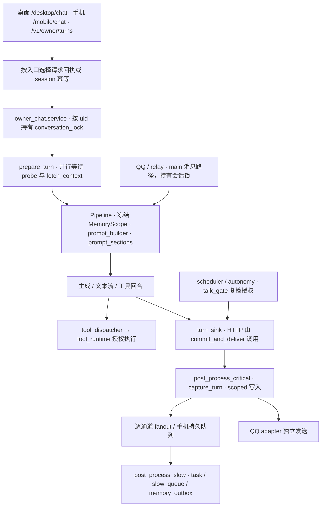

# PresenceKit P2 启动基线

2026-11-22。已整理 P2-0 的现状调用图、迁移候选和生产脱敏基线。第一轮启动闸门仍待关闭，P2-1 至 P2-4 待施工。

本地审计组合为后端 `7e7af8eef34a9adfdd280755409f9a7e4aec7015`、桌面 `c04db24e07d3038e12320baa64572c6e674cac37`、手机 `abb8d504bee304957d865cc6de2c2cecb9c67715`。本地共享协议 fixture 和后端活动合同通过，分别为后端 111、桌面 4、手机 5 项。三仓合同 CI 与恢复演练证据仍归属 [第一轮合并组合](round1-delivery.md)，新组合尚无固定 SHA CI 结果。

## 启动检查和生产基线

只读统计 11 月 18 日 09:34 至 11 月 22 日 09:34（上海时间）的日志和台账。85 条完成回合有 owner-chat timing。18 条主动投递回执均为 accepted，桌面通道接受 18 次，手机持久收件 ACK 18 次。桌面没有正文 ACK。TTS 按本轮安排跳过，标为 NOT VERIFIED。

| 完成回合 | 样本 | context p50 / p95 | prompt p50 / p95 | total p50 / p95 |
|---|---:|---:|---:|---:|
| 桌面 | 28 | 0.81 / 1.31 秒 | 0.15 / 0.16 秒 | 4.70 / 30.34 秒 |
| 手机 | 57 | 0.83 / 15.06 秒 | 0.15 / 0.16 秒 | 8.28 / 21.68 秒 |

按已有 `[owner_chat/timing]` 日志取最近秩分位数。context 是整段耗时，失败和取消不进入该表。同期 API 台账另有 22 条 chat timeout 尝试，含接管前尝试。

Windows Python 3.12.13 另以 `memory_event_baseline`、`test_vector_store` 和 `test_prompt_ablation` 的公开 fixture 采样。每组 3 次预热、30 次有序采样，使用隔离数据目录。Event Log/Context 使用两个角色各一条事件并保持 embedding 离线，向量测试为一行四维 SQLite 索引，Prompt 使用已取好的证据。

| 合成场景 | p50 / p95（ms） | 可观测结果 |
|---|---:|---|
| Event Log 搜索 | 61.570 / 71.026 | 命中本角色，另一个角色的证据为空 |
| Pipeline context | 300.841 / 345.929 | 保留目标历史，无另一个角色内容 |
| SQLite 向量查询 | 9.737 / 12.134 | scoped top-1 与 fixture 相符 |
| 普通 prompt 构造 | 105.054 / 115.211 | 1,950 字符，约 1,147.1 tokens |
| 超预算 prompt 构造 | 107.773 / 129.028 | 裁去 Event Log 层后 1,917 字符，约 1,127.6 tokens |

合成结果仅适用于上述规模和既有 fixture。实际 provider usage、规模化召回质量和带生产等价路由的预算仍待验证。后续按相同公开 fixture、scope、路由和并发条件对照，区分模型传输与本地 context。

生产同期桌面 7 次、手机 9 次 HTTP 500。终态附近有上游 403、400 和 5xx，最近两次手机 500 周边为上游 503 无可用线路。上游 400 的请求或适配原因待核验。11 月 17 日已确定的额度拒绝接管修复已提交本地，但当前 SHA CI 和实际部署尚未验证，第一轮故障基线仍不能签收。详见 [额度接管与近期错误证据](first-send-quota-failover.md)。

## A. 调用图与副作用边界

| 边界 | 当前行为与证据 |
|---|---|
| HTTP 与并发 | [桌面](../../admin/routers/chat.py) 对稳定请求 ID 以回执记录 running／终态。[手机](../../admin/routers/mobile.py) 走 legacy owner context 或显式 session。[owner turn](../../admin/routers/owner_turn.py) 另有调用者身份和幂等入口。[owner chat](../../core/owner_chat/service.py) 持 uid 锁跨 prepare、generate、commit，此锁与记忆文件的读改写锁分开。 |
| 读取与生成 | [prepare](../../core/owner_chat/prepare.py) 并行 probe 和 context。[Pipeline](../../core/pipeline.py) 做低信息跳过、一次 query embedding、按来源及 scope 取证据，再构造 prompt。[generation](../../core/owner_chat/generation.py) 管理流首包、协议过滤、WS 增量和异常收尾。工具只经现有授权运行时执行。 |
| 写入与发送 | [turn sink](../../core/turn_sink.py) 在 fanout 前 await critical。capture 恢复意图先于首个投影，短期历史、日记账与事件证据分阶段写入和补偿。手机队列、逐通道发送和收件 ACK 分开。禁用 fanout 的 [QQ adapter](../../main.py) 在 sink 返回后独立 await 可见发送，slow 调度可能在 QQ 发送前注册。 |
| 后处理和重入 | HTTP 在 fanout 后注册 slow 段。只有既有 durable [outbox](../../core/post_process/memory_outbox.py) 登记的任务可重启补偿，保留 scope、turn_id 与完成条件。失败或未知投递继续查回执。QQ 已持锁时使用 `bypass_gate=True`。 |
| 主动与 Dream | [talk gate](../../core/autonomy/talk_gate.py) 检查准入、会话锁与发送时授权，主动投递回执和发言预算分属既有记录者。[Dream pipeline](../../core/dream/dream_pipeline.py) 自持 Dream 状态和 capture，单独验证入口与退出隔离。 |

源文件行数／Python AST import 语句数，包含局部 import。pipeline 2,873／206，prompt_builder 1,894／79，turn_sink 591／38，owner_chat/service 192／23，autonomy/runner 1,571／80，scheduler/loop 1,269／90。语句数与唯一依赖数分开。

## B. 目标边界与迁移候选

| 当前耦合 | 拟迁移范围 |
|---|---|
| `Pipeline.fetch_context` 同管时间意图、召回策略和上下文组装，`prepare_turn` 已独立。 | 保留 Pipeline facade。先提纯时间窗、检索请求和证据组合，再将存储访问委托给对应服务。 |
| `prompt_builder.build` 直接取部分证据，执行渲染、消融和裁剪。`prompt_sections.arrange_sections` 已负责分区排序。 | 先提纯可独立验证的层渲染与预算，显式传入证据、时间和预算，沿用排序器、`_layer` ID 和同优先级原子裁剪。 |
| `pipeline.run_agentic_loop` 管理分步模型调用、授权后的工具执行及流收尾。 | 保持 owner_chat generation 的 HTTP/WS 编排，提取纯回合策略，副作用仍经现有 dispatcher 稳定 API 和 sink。 |
| `scheduler.loop` 调 autonomy runner，runner 又回查 loop 的活动状态；scheduler 维护还反查 `admin.routers.perception.cleanup_visual_trace`。 | 抽出共享的活动读取端口和视觉 trace 清理服务。scheduler 与 HTTP adapter 共同调用领域服务。保留 talk gate 与 ledger 的写权限。 |
| 手机 router 从桌面 chat router 取 preflight/session helper。运行配置在 config loader 读，运营写通过 config control 合并和原子保存。 | 将公共 preflight 移至已有 owner/session 服务。router 持有协议和错误映射。配置先核对 schema 与默认值，再迁移内部读写接缝。 |

目标依赖为 adapter → 编排 → 领域服务与纯策略 → 持久化端口。domain 不反查 HTTP router 和工具 dispatcher 实现，已归属 sink/ledger 的副作用只从其授权入口触发。上述反向依赖尚未移除。

逐层名册与来源门控以 [层文档](../prompt-layers.md) 和 [构建器](../../core/prompt_builder.py) 同步。P2-1 需冻结最终顺序和裁剪元数据。保持核心层 `5.1_user_facts`、`6a_user_identity`、`9_history`、`11.7_pinned_facts`、`12_user_message` 的现行准入，保持 `6b_event_search` 30、`web_recall` 35、`mid_term` 40、`6c_episodic` 70 的优先级。Dream 余韵详细层与软层仍互斥、优先级 10。保留 15,000 字符告警和超过 30,000 字符向 28,000 裁剪的算法。展示用估算 tokens 与真实 provider usage 分开。金样本应覆盖引用历史、工具 pins、Reality/Dream、web 以及低质量模型的格式差异。

## C. 数据记录与对账

| 数据 | 所有权、投影与保留 |
|---|---|
| 短期历史 | short term 持有 scoped history，按 speaker 与 turn_id 区分回合。prompt 读 scrub 后视图。capture 补写不重复追加，保留现行上限和 accessor。 |
| 日事件与 Memory Event | Event Log 日文件继续作为兼容搜索证据，full_log 供导出。Memory Event SQLite 持有结构化证据和血缘。双写按 scope/turn/source 对账，支持指纹去重和中断字节补齐。搜索默认 30 天，归档年龄单独配置；结构化遗忘走 scoped tombstone。 |
| Mid-term、episodic | 各 scoped store 持有摘要或情景派生记录，以 source_event_ids、source_turn_id、source_mid_ids 追溯。Mid-term 过期清理和 20 条上限，prompt 至多 8 条。Episodic 淘汰可进 storyline inbox，回放从原血缘补缺。 |
| Identity、用户事实、hidden state | identity.yaml 是稳定行为投影，用户事实与用户隐性状态各自有写端。身份补偿先比较当前状态，优先保留更新事实。hidden state 按现有衰减和 buckets 管理，Dream 按 tag 门控读，余韵沿用独立 TTL。 |
| 向量、storyline | 向量按 scoped source/source_id 查询，主记忆索引由 canonical 证据重建，janitor 有界补缺。重建主索引须保留独立 web 来源。叙事弧用 append API，inbox 是输入暂存，两者按既有上限淘汰。 |
| 主动投递和补偿 | Autonomy store 持有机会、run 与每次投递回执，proactive ledger 记发送间隔和日预算，outbox 持有补偿状态。scope、因果 ID、TTL 与通道 ACK 各自检查。未知投递不自动重发，补偿完成后清除执行快照正文。 |

各数据路径、权限、provenance 和兼容读取见 [记忆合同](../memory.md)。故障对账以 [第一轮故障矩阵](round1-fault-matrix.md) 为起点，先做只读核验。

## D. 测试与风险矩阵

| 批次 | 待保留的验证入口与风险 |
|---|---|
| P2-1 | `test_ar02_dependency_directions.py`、`test_desktop_chat_receipts.py`、`test_protocol_fixtures.py`。补缺失的功能入口金样本，验证精确 prompt、错误终态、工具回执、旧客户端和跨角色空结果。 |
| P2-2 | `test_prompt_sections.py`、`test_pipeline_memory_scope_integration.py`、`test_tool_loop.py`、`test_turn_sink.py`。对照层顺序、字符和 usage、流已可见、工具后空回复、原生 Gemini 签名与发送前撤权。 |
| P2-3 Memory | `test_round1_slow_recovery.py`、`test_round1_event_log_idempotency.py`、`test_memory_event_baseline.py`、`test_memory_event_shadow_recall.py`。沙盒注入半条写入、退出、投影缺失、跨角色和重复补偿；记录分层耗时与召回质量。 |
| P2-3 Autonomy 与配置 | `test_round1_autonomy_delivery.py`、`test_phone_ambient_autonomy.py`、`test_scheduler_autonomy_effective_state.py`、`test_admin_config_control.py`。用受控时钟覆盖新旧触发合流、冷却、预算、无接收端、夜间、重启和发送前撤权，注入配置验证与原子写失败。 |
| P2-4 | 核对程序入口和打包行为、Python 3.10/3.12 与三仓固定 SHA 合同。管理面静态行为实际变化时再跑对应浏览器验收。 |

各批同条件比较 p50/p95、超时、context 字符与 provider usage。分层离线基线未齐，暂不判断退化幅度。出现新漏发、双发、工具重复、错位记忆或跨角色泄漏时回滚该批。

## E. 迁移顺序与回滚

1. P2-0 整理证据，关闭启动闸门后才进入 P2-1 守卫与金样本。现存反向 import 先挂账，守卫不宣称已移除。
2. P2-2 每批迁一个纯渲染、预算或 Pipeline 边界。保留原签名和 facade，先迁最小调用群，按批使用独立 commit 与基线测试恢复。
3. P2-3 先交证据与 dry-run，再收口已验证的重复读取、状态、门控与配置写。保留原数据路径、schema、TTL、权限、旧读者和恢复队列。
4. P2-4 两份 README 的产品列车写 v1.1.0，三仓 GitHub latest 均为 v1.3.0。后端 package 与桌面源码为 1.3.0，手机 pubspec 为 1.3.0+87、第一轮签名安装包为 +88。Desktop wire v0.1 独立冻结。
5. requirements-core 为运行底座，full 引入 core，test 引入 full，stt 为独立可选项，发行用 full 编译锁定文件。现有 CI 有 3.10/3.12 矩阵，本轮 P2 锁定安装验收尚未运行。LICENSE 和 metadata 指 PolyForm Noncommercial 1.0.0，GitHub 显示 Other，正式许可文本保留。
6. 四个 AA 脚本和 run_test.py 都按现行入口核对源码、文档、发行包及升级脚本引用。若移动，先保留兼容入口，明确退役窗口后再移除。独立临时测试脚本可列为删除候选，当前缺少足够调用证据。程序回滚沿用 [第一轮回滚手册](round1-rollout-and-rollback.md) 的逐文件边界。
