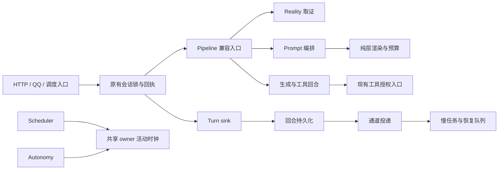

# PresenceKit P2 交付记录

[工单](../../cc-tasks/PresenceKit_Round2_P2_Architecture.md)的五项架构产出以 [P2-0 基线](round2-p2-baseline.md)为施工前快照。基线包含实际调用图、依赖候选、数据真相源和测试风险。下表记录逐批提交与施工后的模块责任。

| 阶段 | 变更与验收 |
|---|---|
| P2-1 · `d58d446` | 为 owner chat 禁止反查 HTTP router、Prompt 纯层禁止依赖 I/O 加守卫。109 项定向回归覆盖 Reality 层顺序、预算裁剪后的引文、Dream 消融、桌面回执和共享协议。 |
| P2-2 · `2190d08`、`4629d92`、`14e64b3`、`8f1ce66`、`63d06fc` | Prompt 预算、Reality 取证、工具回合、回合效应和纯渲染分别提交。各批通过 98、117、159、133、124 项定向回归。 |
| P2-3 · `b615dc2`、`5d76de2`、`b77e4e2` | 记忆只读对账、共享活动窗口、配置快照分别通过 57、250、76 项定向回归。各批覆盖范围有重叠。 |
| P2-4 · `f9cc3cc` | 校对版本、依赖和许可证。换行与协议矩阵检查、模拟 Garden 启动和锁文件 dry-run 通过。 |

## 当前依赖与故障边界

- `core/memory/reality_context.py` 在一次冻结的 Reality scope 内取证。时间事实检索故障会记日志并继续组装上下文，新增回归覆盖这个故障分支。Dream 继续使用自己的上下文、捕获与退出路径。
- `core/prompt_sections.py` 渲染历史和日记，`core/prompt_budget.py` 负责预算。复用已有排序器，保持层 ID、来源门控、15,000 字符告警和超过 30,000 字符时向 28,000 字符裁剪的规则。同优先级层一起处理。
- `core/owner_chat/generation.py` 管理 HTTP 文本流，`core/owner_chat/tool_loop.py` 管理模型步骤和工具收尾。回执、授权、幂等和实际工具执行继续由原有入口负责。`core/post_process/turn_effects.py` 按冻结的 scope 调用原有持久化及后处理，`turn_sink` 仍拥有关键写入与投递顺序。QQ 独立发送的既有时序保留。
- `core/memory/vector_reconciliation.py` 共享 janitor 与诊断的缺失投影识别。`python -m scripts.check_memory_projections --owner <uid> --character <char_id>` 读取 canonical 和索引数量。诊断跳过会补登记所有权的 legacy 读路径，索引缺失时保持只读，由原 janitor 完成修复。数据库结构、历史读取兼容、provenance 和恢复队列沿用现有合同。Recall 渲染在同一阶段只读一次 mood。
- `core/conversation_activity.py` 合并进程内的 owner 活动时钟。Autonomy、记忆巩固和键盘活动接入不再从 scheduler loop 读写时间。Scheduler 清理视觉 trace 直接调用 core 服务。Signal、Opportunity、Run 和 talk attempt 继续分别记录输入、候选、评估和投递，沿用已有因果 ID。保留所有 DND、Dream、预算、去重与发送前授权。上线前保留的 100 条自治运行记录中，93 条 `circuit_open`、6 条 `blocked_user_active`、1 条 `llm_failed`，仅用于解释该样本的无声原因。
- `core/config_yaml.py` 集中根键值映射校验。运行时一次读取绑定同一文件的版本，验证成功后一起发布原始和生效快照。测试覆盖坏配置、读取期间原子替换和环境覆盖隔离。文件仍由 `admin/config_control.py` 原子写入，字段默认值和跨字段规则仍由各自设置域校验。

## 兼容与回滚

- 变更在后端仓库。Desktop、Mobile 不需更新协议或配置。`/desktop/chat`、`/ws/desktop` 等 wire v0.1 入口、请求和回执标识以及数据路径继续按现行合同使用。
- 手机 router 继续复用桌面 router 的会话 grant 和请求适配。该依赖属于 HTTP 适配层，保留在基线的后续迁移候选中。
- 三仓 GitHub 最新正式发行均为 v1.3.0。后端 `pyproject.toml` 包版本对应发布线，wire v0.1 独立维护。`LICENSE` 与包元数据均为 PolyForm Noncommercial 1.0.0，GitHub 识别显示 Other。
- Windows 发布锁由 Python 3.12 编译，带哈希 dry-run 可以解析。3.10 直接使用该发布锁会被 `numpy` 的 Python 版本要求拒绝，3.10 的 Windows `requirements-full.txt` 独立解析成功。Core 提供必要运行依赖，full 追加可选功能，STT 依赖独立维护，test 在 full 基础上加入测试工具。保留 3.12 发布锁，3.10 和 3.12 CI 从依赖清单安装。
- Garden 手动探针移到 `scripts/garden_injector_smoke.py`，旧 `python test_garden_injector.py` 入口兼容到至少 v1.3 系列结束。下一条发布线复核外部调用后再议退役。四个 `AA*.bat` 和 `run_test.py` 都有当前安装或验证调用者，继续作为正式入口。
- 合并前可按批次反向 revert。跨批回滚时，按配置、活动时钟、对账、纯渲染、回合效应、工具回合、Reality 取证、预算的逆序恢复。若上线后需回滚，按照[第一轮回滚流程](round1-rollout-and-rollback.md)恢复本次程序文件并复核健康、路由和投递。该重构没有存储迁移步骤。

## 离线性能复测

在同一 Windows Python 3.12 环境依次测 `d58d446` 的 Pipeline、Prompt Builder 与交付版。`python -m pytest -q -s tests/round2_p2_benchmark.py` 用隔离 fixture，每组预热 3 次、采样 30 次。两轮各通过 3 个场景断言。普通 Prompt 保持 1,950 字符、约 1,147.1 tokens，超预算 Prompt 保持 1,917 字符、约 1,127.6 tokens，裁剪和跨角色断言一致。

| 场景 | 重构前 p50 / p95（ms） | 交付版 p50 / p95（ms） |
|---|---:|---:|
| Event Log 搜索 | 13.209 / 17.204 | 14.311 / 16.953 |
| Pipeline context | 71.967 / 86.849 | 74.508 / 81.585 |
| SQLite 向量查询 | 2.736 / 3.184 | 2.415 / 2.737 |
| 普通 Prompt | 26.744 / 30.567 | 25.146 / 27.314 |
| 超预算 Prompt | 24.791 / 29.392 | 24.971 / 29.603 |

## 实际运行验收

P1 额度接管的隔离验证和生产上线证据见[额度接管交付](first-send-quota-failover.md)。现有上游 HTTP 400 样本缺少可用参数字段，仍待查因。历史生产性能数据见 [P2-0 基线](round2-p2-baseline.md)。P2 的生产联调、真机操作、真实模型 usage 与实际 TTS 在当前记录为 NOT VERIFIED，TTS 按用户安排跳过。
